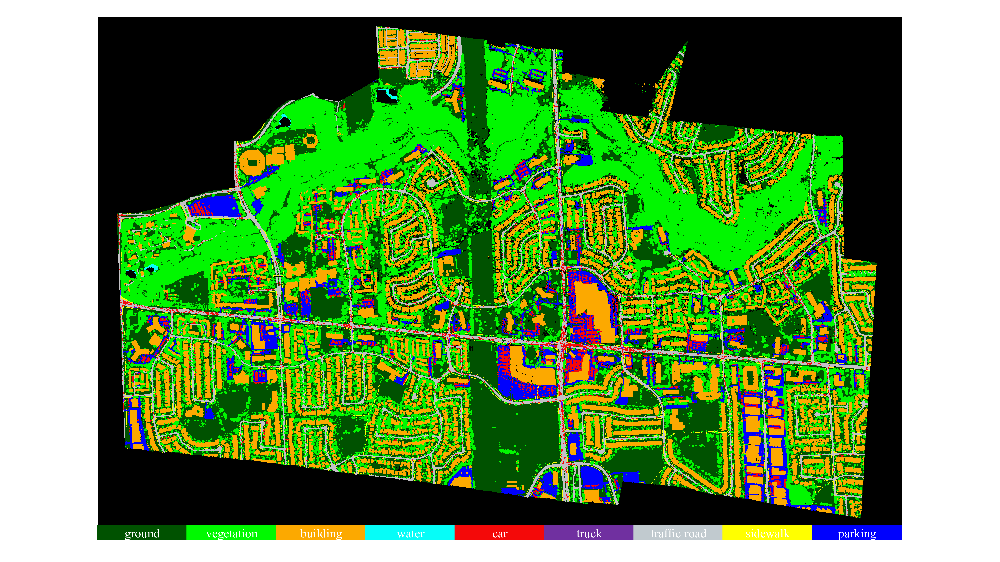

# YUTO: A Large Scale Aerial LiDAR Data Set for Semantic Segmentation
This is the official repository of the **YUTO Semantic** dataset.


### Overview
<p align="center">  </p>

YUTO Semantic is a multi-mission large-scale aerial LiDAR dataset specifically designed for 3D point cloud semantic segmentation. The dataset comprises approximately 738 million points, covering an area of 9.46 square kilometers of York University Campus in Toronto, Ontario Canada.  Each point in the dataset is annotated with one of nine semantic classes.

<p align="center">  </p>

The campus was flown in three missions with Teledyne Optech Galaxy airborne LiDAR: September 2018, December 2019 and May 2021. **The current release (v1) contains one mission, Galaxy 2018 Fall.** Labels for the other two missions will follow. Details of the dataset can be found in the [ISPRS GSW 2023 paper](https://doi.org/10.5194/isprs-archives-XLVIII-1-W2-2023-209-2023).

> **Data format.** v1 is distributed on Hugging Face as 41 `.las` tiles (600 m × 600 m, about 34 GB in total). The paper mentions `.ply`; the released files are `.las`.

### Available Classes
* Ground: This class includes unpaved surfaces, grass, and natural terrain.
* Vegetation: This class encompasses trees, bushes, and other forms of vegetation.
* Building: This class represents both commercial and residential buildings.
* Water: This class includes bodies of water such as lakes and rivers.
* Car: This class includes all types of vehicles except for commercial trucks.
* Truck: This class specifically represents commercial trucks.
* Traffic Road: This class corresponds to vehicle roads.
* Sidewalk: This class represents pedestrian walkways.
* Parking: This class represents parking lots.

### Available Attributes
* x, y, z: The position coordinates of each point recorded in UTM zone 17N using the NAD83 horizontal datum.
* Intensity: The normalized LiDAR intensity value of each point, ranging from 0 to 255.
* Number of Return: The number of times the laser pulse was reflected back.
* GPS time: The GPS time of each point, providing temporal information about the data acquisition.
* Scan Angle: The scan angle of each point, indicating the angle at which the laser beam hit the target.
* Class: The label assigned to each point, representing the semantic class or category of the object or surface the point belongs to.

### Train / Test Split
Following the paper, the 41 tiles are split into **32 training tiles** and **9 test tiles**. The tile lists are in [`splits/train.txt`](splits/train.txt) and [`splits/test.txt`](splits/test.txt). All results below use this split. No official validation split is defined; if you need one, hold it out from the training tiles and report which tiles you used.
<details> <summary><strong>Test tiles</strong></summary>

```python
self.test_file_name = [
    "618175.81_4846250.00__618775.81_4846850.00",
    "618775.81_4844450.00__619375.81_4845050.00",
    "618175.81_4846850.00__618775.81_4847450.00",
    "618175.81_4848650.00__618775.81_4849250.00",
    "618175.81_4847450.00__618775.81_4848050.00",
    "618775.81_4845050.00__619375.81_4845650.00",
    "618175.81_4848050.00__618775.81_4848650.00",
    "618775.81_4845650.00__619375.81_4846250.00",
    "618775.81_4846250.00__619375.81_4846850.00"
]
```

</details>

### Semantic Segmentation Results
Metrics are OA (%), mIoU (%) and per-class IoU (%) on the 9 test tiles. mIoU is the unweighted mean over all 9 classes.

| Method                             | OA    | mIoU  | ground | vegetation | building | water | car   | truck | traffic road | sidewalk | parking |
|------------------------------------|-------|-------|--------|-----------|----------|-------|-------|-------|--------------|----------|---------|
| PointNet (Qi et al., 2017)         |  --   | 33.22 | 74.50  | 76.80     | 63.30    | 0.00  | 39.94 | 0.00  | 15.10        | 0.00     | 29.80   |
| PointNet++ (Qi et al., 2017)       |  --   | 26.16 | 68.10  | 66.70     | 31.80    | 0.00  | 14.10 | 0.00  | 26.00        | 2.50     | 26.20   |
| SPG (Landrieu et al., 2018) ⚠️     |  --   | 36.68 | 79.31  | 97.92     | 0.00     | 57.37 | 0.00  | 36.92 | 0.39         | 39.51    | 0.00    |
| SFL-Net (Li et al., 2023)          |  --   | 51.05 | 80.91  | 94.10     | 88.33    | 0.00  | 74.47 | 0.00  | 53.71        | 23.08    | 44.81   |
| RandLA (Hu et al., 2020)           | 84.19 | 58.37 | 80.61  | 94.44     | 95.39    | 3.34  | 74.59 | 13.87 | 78.10        | 23.43    | 61.56   |
| KPConv (Thomas et al., 2019)       | 85.22 | 56.14 | 86.94  | 96.25     | 94.01    | 0.00  | 84.02 | 0.00  | 79.93        | 3.26     | 60.83   |
| EyeNet (Yoo et al., 2023)          | 87.41 | 63.44 | 86.26  | 95.94     | 96.78    | 13.61 | 83.02 | 14.26 | 84.65        | 31.08    | 65.34   |

* RandLA, KPConv and EyeNet: Table 2 of the YUTO Semantic paper. RandLA and KPConv are internal runs with hyperparameters taken from SensatUrban/DALES, so they are not fully tuned.
* PointNet, PointNet++, SPG and SFL-Net: not reported in the paper. Experimental settings will be documented.
* ⚠️ SPG: the reported mIoU (36.68) does not match the mean of its per-class IoUs (34.60). This row is under review.


### Downloads
- [YUTO Semantic on Hugging Face](https://huggingface.co/datasets/ausmlab/yuto-semantic)

> The paper links to `github.com/Yacovitch/YUTO_Semantic`. That is an earlier copy. **This repository (`ausmlab/yutosemantic`) is the official, maintained one.**

### License
- **Dataset** (point clouds and labels): [CC BY-NC 4.0](https://creativecommons.org/licenses/by-nc/4.0/), as stated on Hugging Face. Non-commercial use only.
- **Code** in this repository: MIT (see [`LICENSE`](LICENSE)).


### Citation
If you find our work useful in your research, please consider citing:
```bibtex
@article{yoo2023yuto,
  title     = {{YUTO Semantic}: A Large Scale Aerial {LiDAR} Dataset for Semantic Segmentation},
  author    = {Yoo, S. and Ko, C. and Sohn, G. and Lee, H.},
  journal   = {The International Archives of the Photogrammetry, Remote Sensing and Spatial Information Sciences},
  volume    = {XLVIII-1/W2-2023},
  pages     = {209--215},
  year      = {2023},
  publisher = {Copernicus GmbH},
  doi       = {10.5194/isprs-archives-XLVIII-1-W2-2023-209-2023}
}
```

### Acknowledgements
This dataset was collected with Teledyne Optech's Galaxy LiDAR. The work was supported by NSERC (CRD: 3D Mobility Mapping Artificial Intelligence) and Teledyne Geospatial Inc.
